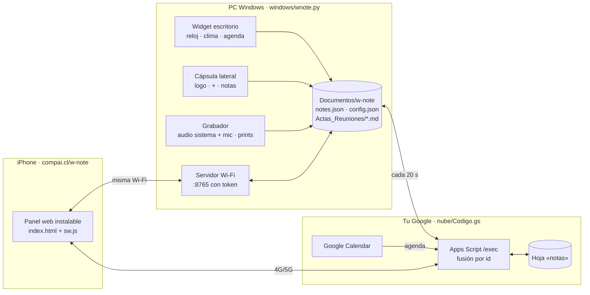

# w-notes de compA\

Notas de vidrio, widget de escritorio, grabador de reuniones y panel para el celular.
PC (Windows 10/11) ⇄ nube propia (Google Apps Script + Hoja) ⇄ iPhone por 4G/5G o Wi-Fi.

| Carpeta / archivo | Qué es |
|---|---|
| `windows/wnote.py` | La app de Windows (una sola pieza, PySide6) |
| `windows/instalar.bat` · `instalar.ps1` | Instalador de doble clic; `desinstalar.bat` la quita |
| `windows/requirements.txt` | PySide6, Pillow, PyAudioWPatch, qrcode |
| `nube/Codigo.gs` · `appsscript.json` | El «servidor» gratis en tu cuenta Google |
| `index.html` · `manifest.webmanifest` · `sw.js` | Panel del celular (se publica en compai.cl/w-note) |
| `marca/` | Logo oficial en SVG, PNG 16–512, `.ico`, versión negra, una tinta y chica |

---

## 1. Instalar en el PC (2 min)

1. Descarga la carpeta `w-note` completa.
2. Doble clic en **`windows/instalar.bat`**.
   Busca Python (si falta, lo instala con winget), instala dependencias, crea accesos directos
   (Escritorio, Menú Inicio, Inicio de Windows) y abre w-note.
3. Si Windows pregunta por el Firewall → **Redes privadas** (es el panel Wi-Fi del celular).

Queda en la bandeja junto al reloj. Clic derecho → **Salir**. Clic en el widget (o en su logo) abre la app; la configuración está en ⚙.

Ubicación y clima: automáticos como la intranet (ubicación del equipo → por red → Santiago). Se puede fijar en ⚙ → Ubicación.

| Atajo global | Acción |
|---|---|
| `Ctrl+Alt+N` | Nota rápida sobre cualquier app |
| `Ctrl+Alt+R` | Grabar / detener reunión |
| `Ctrl+Alt+P` | Print de pantalla clave (mientras graba) |

## 2. Nube para el iPhone por 4G/5G (3 min, una vez)

compai.cl es GitHub Pages: sirve archivos, no recibe datos. Por eso la nube vive en tu Google.

1. Abre <https://script.google.com/create> (proyecto nuevo de Apps Script).
2. Borra lo que haya y pega `nube/Codigo.gs`. La hoja «w-note · notas» se crea sola en tu Drive.
3. ⚙ **Configuración del proyecto** → activa «Mostrar el archivo de manifiesto appsscript.json» →
   vuelve al editor, abre `appsscript.json` y pega el de `nube/appsscript.json`
   (activa Google Calendar API para traer el link de Meet).
4. Elige la función **`configurar`** → **Ejecutar** → autoriza. En el registro sale el **TOKEN**.
5. **Implementar → Nueva implementación → Aplicación web**.
   Ejecutar como: **Yo** · Quién tiene acceso: **Cualquier usuario** → Implementar → copia la URL que termina en `/exec`.
6. En w-note (PC): pega URL y token en la barra **Nube iPhone** → **Probar**.
7. **📱 Vincular celular** → escanea el QR con la cámara del iPhone → Safari → Compartir → **Agregar a inicio**.

> La agenda sale del calendario de la cuenta con que creaste el script.
> Para otros calendarios: en el script, Configuración → Propiedades → `CALENDAR_IDS` = `id1,id2`.
> ¿Se filtró el token? Ejecuta `rotarToken` y vuelve a vincular.

**Sin nube** también funciona: con el celular en la misma Wi-Fi, el QR «Misma red Wi-Fi» abre el mismo panel servido por tu PC.

## 3. Cómo se sincroniza

- Cada nota tiene `id`, `updated_at` y `deleted`. PC, nube y celular fusionan igual: **gana el cambio más reciente**; archivar deja una «lápida» 30 días para que el borrado llegue a todos. Nadie pisa la lista de otro.
- El PC sincroniza 1,5 s después de cada cambio y cada 20 s; el celular cada 15 s con la app abierta. Sin señal, el celular guarda local y sube al volver.

## 4. Actas — formato estándar compAI

Cada grabación genera `AAAA-MM-DD_Organizacion_Tema.md` con esta estructura fija:

| Bloque | Contenido | Lo llena |
|---|---|---|
| Encabezado | Título «ACTA DE REUNIÓN», tema y organización | w-notes |
| Ficha | Código `ACTA-AAAAMMDD-NN`, fecha, horario y duración, organización, tema, plataforma + enlace, participantes, redacta | w-notes (participantes: tú) |
| 1. Objetivo | Una línea: para qué fue la reunión | tú |
| 2. Desarrollo | Tabla minuto · nota (las notas en vivo) | w-notes |
| 3. Momentos clave | Cada Print con su minuto e imagen | w-notes |
| 4. Acuerdos | Tabla # · acuerdo · responsable · plazo | tú |
| 5. Próximos pasos | Lista de casillas | tú |
| 6. Respaldos | Audio del sistema, micrófono y capturas | w-notes |

«Redacta» se cambia en ⚙ → Grabación y actas.

### Archivos

`Documentos/w-note/Actas_Reuniones/AAAA-MM-DD_Organizacion_Tema.md` (+ `.wav` del sistema, `_microfono.wav` y `Capturas_Clave/`).
Al grabar desde el widget, organización, tema, plataforma y link salen del evento de Calendar
(organización = dominio del primer invitado externo).

## Qué cambió respecto del borrador `w_note_windows_app_cloud_sync_iphone_4g_5g.py`

| Antes | Ahora |
|---|---|
| Sync a `compai.cl/api/wnote` (no existe: el sitio es estático) | Apps Script propio, probado con el mismo protocolo |
| El PC subía su lista completa y pisaba lo del celular; borrar no se propagaba | Fusión por id + lápidas, idéntica en las 3 partes |
| Logo dibujado como círculo con degradado azul | Isotipo oficial del manual (SVG), versión chica bajo 40 px |
| Agenda, clima y notas iniciales de ejemplo (Banco Andes, 20°) | Google Calendar real, clima real (Open-Meteo), arranca sin notas falsas |
| Audio en RAM y WAV fijo a 2 canales / 48 kHz | WAV directo a disco con canales y frecuencia reales; relleno de silencios; micrófono aparte |
| Sin forma de cerrar la app | Bandeja con Salir, instancia única, X oculta la ventana |
| Panel Wi-Fi abierto a cualquiera e inyectaba el texto como HTML | Token obligatorio y texto escapado |
| «ti» detectaba TI en «tiempo», «notificar»… | Palabra completa para claves cortas |
| Sin notas en vivo ni atajos | Campo de notas con marca de tiempo y atajos globales |
